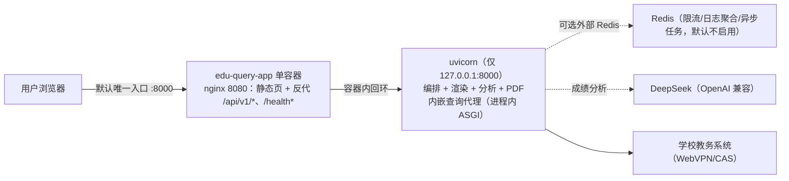

# 教务查询编排 · Stpt-Query

> **单容器双进程（nginx 边缘入口 + uvicorn 应用进程）**：查询、渲染、分析、PDF 与内嵌查询代理同进程运行。
> 对外 JSON 接口统一 `/api/v1/*` 命名与统一语义（信封 + 稳定错误码，见
> [docs/api-semantics.md](docs/api-semantics.md)），不再兼容 Dify 契约。


[](https://www.python.org/)
[](https://fastapi.tiangolo.com/)
[](https://www.docker.com/)
[](https://nginx.org/)
[](https://daringfireball.net/projects/markdown/)

## 目录

- [关于](#关于)
- [技能栈](#技能栈)
- [项目](#项目)
- [架构](#架构)
- [与 Dify 工作流的映射](#与-dify-工作流的映射)
- [当前目标](#当前目标)
- [路线图](#路线图)
- [快速开始](#快速开始)
- [测试](#测试)
- [Kubernetes 迁移就绪](#kubernetes-迁移就绪)
- [仓库结构](#仓库结构)
- [许可](#许可)

## 关于

本仓库是自包含项目，以**单容器**部署：`edu-query-app` 容器内运行 nginx（8080 唯一对外入口）与 uvicorn（仅容器内回环 8000）双进程。查询代理已并入 `app/` 包，以**进程内 ASGI** 方式被调用，负责学校统一认证登录、免密跳转与成绩/课表原始查询；编排层负责固定工作流、成绩/课表渲染、成绩分析 LLM、异常分类与 PDF；nginx 托管查询页面与后台静态资产并反代 API，是默认唯一对外入口。`frontend/` 目录保留为 nginx 资产目录（静态页/模板/入口脚本片段），构建期并入单镜像。

| 项目 | 内容 |
| --- | --- |
| 身份 | 教务查询编排服务（统一 /api/v1/* 语义） |
| 方向 | 教育信息化 · 教务数据服务（信封式 API + 稳定错误码） |
| 方式 | 单容器（nginx + uvicorn 双进程）+ 统一身份认证（WebVPN/CAS）+ OpenAI 兼容 LLM |
| 目标 | 不依赖 Dify 地为页面与自动化脚本提供稳定、可扩展的教务查询接口（统一语义见 docs/api-semantics.md） |

## 技能栈

| 领域 | 内容 |
| --- | --- |
| 后端编排 | Python 3.11 · FastAPI + uvicorn · httpx（登录/跳转/成绩/课表编排与错误分类） |
| 渲染与文档 | Markdown 渲染（1:1 移植原代码节点）· reportlab PDF（内置 CID 中文字体） |
| LLM | OpenAI 兼容协议直连（默认智谱 `glm-4.5-flash`，可关闭深度思考并覆盖系统提示词） |
| 前端 | Nginx 静态页面 + Tailwind CSS 4 品牌令牌（构建期 CLI 编译、运行时零第三方资源）+ 反向代理注入网关令牌 |
| 部署 | Docker Compose 单容器（nginx + uvicorn 双进程）· 单实例默认无 Redis · 内嵌查询代理（免内部网络/内部令牌） |
| 测试与文档 | pytest 单元测试 · K8s 迁移指引 |

## 项目

| 项目 | 简介 | 技术栈 | 状态 |
| --- | --- | --- | --- |
| [单体应用](app/) | 统一 /api/v1/* 语义的查询编排 + 成绩/课表渲染 + 成绩分析 LLM + PDF + 内嵌查询代理（登录/免密跳转/原始查询） | Python · FastAPI · httpx · reportlab · LibreOffice | 活跃 |
| [前端资产](frontend/) | nginx 托管查询页与后台，反向代理 /api/v1/* 并注入网关令牌（构建期并入单镜像） | Nginx | 活跃 |

## 架构



**默认端口与网络隔离**：容器唯一宿主映射 `${APP_PORT:-8000}` → nginx `8080`；uvicorn 仅绑定容器内回环 `127.0.0.1:8000`，宿主与外部均无法直达。查询代理没有独立进程与端口——它在 uvicorn 进程内以 ASGI 方式调用，也不再需要内部网络与内部令牌。

### 服务边界与进程调试

| 进程 | 职责边界 | 监听 | 对外契约 |
| --- | --- | --- | --- |
| nginx（容器内 8080） | 静态页面、CSP/安全响应头、注入网关令牌并反代 /api/v1/* | 容器 `8080` → 宿主 `APP_PORT` | `APP_PORT` 上的页面和受代理 API |
| uvicorn（容器内回环） | 固定工作流编排、成绩/课表渲染、LLM、PDF、日志、异步任务，以及内嵌查询代理（统一认证/会话/免密跳转/原始查询/课表导出） | `127.0.0.1:8000` | Bearer `API_TOKEN` 保护 `/api/v1/run`、`/api/v1/notices*`、`/api/v1/service-status`、`/api/v1/status`；`/health*` 探针有公开/受限契约 |

双进程由 `docker-entrypoint.sh` 守护（`wait -n`：任一退出即容器退出，交由编排重启）。需要直连 uvicorn 做验收时，进入容器用回环地址：

```bash
docker compose exec edu-query-app curl -s http://127.0.0.1:8000/health/ready
```

uvicorn 只监听容器内回环，不对外发布端口；`/metrics` 等运维接口同样只适合容器内或内网访问。

## 学校侧契约与升级路径

对接学校的全部「事实」（域名/路径/端口、RSA 提取正则、csrf/票据盐、
`vpn-12-` 主机映射、会话失效文案与错误码）集中在 [app/school_contract.py](app/school_contract.py)
单一模块；上游端点清单（登录链、SSO 链、管理端、学生服务 8 个业务 API）
登记在 [app/school_endpoints.py](app/school_endpoints.py) 注册表，新增查询端点
经 `J.call()` 调用即可，无需触碰认证编排。测试反重复扫描保证事实不会被复制到
契约之外——**学校侧升级时改契约一处 + 跑自检即可恢复**：

```bash
# 无凭据自检：WebVPN/门户/CAS 三层 + 契约事实逐条判定（不登录、只读 GET）
python scripts/contract_selfcheck.py --json
# 深度自检（真实登录链路验证教务层）
JWXT_HEALTH_USERNAME=... JWXT_HEALTH_PASSWORD=... python scripts/contract_selfcheck.py --deep
```

运行时分层观测：`/health` 与 `/health/public` 的 `school.layers` 给出
webvpn/cas/portal/jwxt 四层三态结论；`/health/deep` 的 stages 逐阶段标注
失败层；`classify_error()` 的 `meta.layer` 提供异常粗归因。
完整取证方法、升级应急流程与接口面扩展指引见
[docs/upstream-contract.md](docs/upstream-contract.md)。

## 与原 Dify 工作流的对照（历史）

> 本节仅为迁移历史对照；当前对外契约已统一为 /api/v1/* 语义，不再兼容 Dify。

| Dify 节点 | 实现 |
| --- | --- |
| 开始节点 | `app/schema.py::WorkflowRequest` |
| HTTP 节点 ×4 | `app/pipeline.py` 调用内嵌查询代理（进程内 ASGI） |
| 代码节点 ×6 | `app/render.py`（1:1 移植） |
| 成绩分析 LLM | `app/llm.py` + `prompts.py` |
| 报错解析 LLM ×4 | `app/classifier.py` 确定性规则 |
| 变量聚合器 | 分支返回值（已消除登录响应泄漏） |
| md_exporter / file_tools | `app/pdf.py` + 内联 Base64 PDF |
| sys.workflow_run_id | `app/trace.py::new_run_id` |
| 3 个 END | `app/schema.py::QueryResult` 单一体 |

## 查询能力与参数

`POST /api/v1/run` 请求体（`WorkflowRequest`，完整字段见 docs/api-semantics.md 第 4 节）：

| 字段 | 说明 |
| --- | --- |
| `option` | `成绩` / `课表` |
| `semesters` | 空=当前学期；单学期（如 `2025-2026-2`）；`all`（全部学期）；`recent:N`（最近 N 学期）；逗号分隔多学期（多学期形态仅成绩适用，上限由查询代理 `JWXT_MAX_SEMESTERS` 约束） |
| `weeks` | 周次（`all`/`1-8,10`），仅课表生效 |
| `include_all` | 附带全部成绩（个人首页）与学分概况，仅成绩适用 |
| `odd_or_double` | 课表单双周 `1`/`2`，透传学校接口原始语义，留空沿用代理默认 `1` |
| `md2pdf` / `check` | 成绩 PDF / LLM 成绩分析 |

首页学期下拉会按 `/api/v1/calendars/config` 返回的学期列表动态重建（后台「校历校准」保存后立即生效）；
日历未启用时回落静态列表。成绩模式下额外提供「全部学期」「最近 3 学期」快捷项。
周数下拉会在公开校历基线（同一接口下发的 `periods`/`terms`，非机密文件基线）可解析出
当前教学周时提供「第 N 周（本周）」快捷项；课表结果还会给出时间上下文——概览徽章
「第 N 教学周 · 星期X（· 第 Y 节进行中）」、桌面表格今天列头与进行中节次行高亮、
移动端按天视图当前节次卡高亮。以上标记仅在**查询周覆盖本周**时出现（历史周次/聚合
数据不做误导性高亮），校历不可解析或日历未启用时全部静默降级。

## 异步查询任务

`POST /api/v1/run/jobs` 用于高峰排队。接口先同步完成学校登录，把密码换成短期
session/任务票据，然后立即返回 `job_id`；队列、去重键、任务状态和结果都保存在 Redis。
**Redis 队列不保存密码**，任务负载不含明文凭据；日志和轮询响应也不返回 session 或 token。

> 单体默认拓扑**不内置 Redis**（单实例、同步查询）。`/run/jobs` 会返回 503 并说明
> 「异步查询未启用」（code=`capacity.jobs_disabled`），前端按稳定错误码回退到
> `POST /api/v1/run`。需要异步排队或多副本时，自备外部
> Redis 并设置 `REDIS_URL`（查询代理侧可同时设置 `JWXT_REDIS_URL`）。

```text
POST /api/v1/run/jobs        请求体与 POST /api/v1/run 相同；受理信封 data={job_id, state, position, poll_url}
GET  /api/v1/run/jobs/{id}   轮询信封 data.state=queued/running/success/failed；终态 data.result 为同形状嵌套信封
```

- 轮询响应包含 `phase`、`phase_index`、`phase_label` 和 `phase_started_at`。阶段依次为
  `queued`（排队）、`dispatching`（等待查询槽位）、`querying`（查询成绩/课表）、
  `analyzing`（成绩分析，可选）、`generating_pdf`（生成 PDF，可选）和 `done`（完成）。
  登录校验在 `/run/jobs` 受理前同步完成，因此拿到 `job_id` 时登录步骤已完成。
- `JOB_WORKERS` 是消费协程数；总活跃任务继续受 `GLOBAL_CONCURRENCY`、`LLM_CONCURRENCY`、
  `PDF_CONCURRENCY` 与内嵌查询代理上游信号量保护。
- 同一学号 + 查询参数在排队/执行中自动去重；终态结果按 `JOB_RESULT_TTL_SECONDS` 保留。
- Redis 未配置或运行中不可用时，异步受理返回 503；前端按稳定错误码（`capacity.jobs_disabled`）识别后回退 `POST /api/v1/run`，
  默认单体部署（单实例、无 Redis）即为此模式。

## 网络日历订阅（只读 ICS）

把课表订阅到手机 / 电脑日历：**页脚常驻入口**可查询某个学号是否已开启、一键开启并复制订阅地址、
随时关闭；**课表查询成功后**结果区会直接显示订阅状态（未开启 / 已开启 / 需重新授权）。

| 入口 | 说明 |
| --- | --- |
| 页脚「📅 网络日历订阅」 | 复用页面上的学号与密码（仅内存，不写 localStorage）查询状态、开启、刷新、轮换、关闭 |
| 课表结果区 | 查询成功即显示状态；密码刚被学校接受时为零额外登录的权威判定 |
| 后台「网络日历」标签页 | 列出已开启的学号、状态、刷新间隔与失败次数；支持按学号查询、按状态筛选（SQL 内过滤，total 与分页一致）、立即刷新、暂停/恢复、轮换地址、彻底删除（**不展示完整订阅地址**） |
| 后台「校历校准」标签页 | 校准各节次起止时间与来源（官方确认/推断）、定义每学期第一周（周一、正式上课首日、教学周数、节假日）；保存后持久化到后台数据库并立即生效，可一键恢复仓库默认值 |

### 添加到日历（设备识别 + 一键导入）

订阅地址是长期密钥，因此页面在**默认掩码**的前提下提供「添加到日历」指引：

- **设备/浏览器识别**：区分 iPhone / iPad / Android / macOS / Windows / Linux，并识别微信、QQ、
  钉钉、支付宝、飞书等**内置浏览器**。命中内置浏览器时会提示「在浏览器中打开」，或改用扫码；
- **手动订阅为主，深链为辅**：面板主操作是「复制订阅地址」，各平台按步骤在日历 App 里
  「新建日历订阅 / 添加已订阅的日历 / 从 Internet 订阅 / 通过网址添加」粘贴即可；
  `webcal://` 深链只作为**可选尝试**（部分系统会把它当一次性导入、要求 HTTPS，或对本地/内网地址
  直接报错「导入错误」，因此不再作为唯一入口）；
- **一键导入尝试**（本地方式，订阅地址不经第三方服务器）：
  - Apple 设备 / macOS：`webcal://` 交给系统「日历」并询问是否订阅（失败请改手动订阅）；
  - Windows：`webcal://` 交给 Outlook / 系统日历（失败请改手动订阅）；
  - Android：Google 日历网页版添加链接（会标注为第三方抓取），
    以及 `navigator.share` 分享 `.ics` 给已安装的日历 App（华为/小米/OPPO/vivo 等）；
  - 通用回退：复制订阅地址、下载 `.ics`（一次性导入，**不会自动更新**）；
- **唤起结果检测**：点击 `webcal` 后若页面在 1.5 秒内仍未失焦，则判定没有对应日历 App 并提示改用其他方式，
  不谎称「已添加成功」；
- **扫码订阅**：显式点击「生成扫码图像」后由服务端本地编码（复用已有 reportlab，不经任何第三方二维码/短链服务），
  前端按设备像素比在 canvas 上绘制 `webcal://` 二维码；关闭面板即清除已生成的二维码；
- **第三方提示**：Google 日历、Outlook 网页版会让对应服务端抓取订阅地址（地址即密钥），UI 中明确标注，
  由用户决定是否接受；
- **未启用时自动收起**：页面初始化会探测 `/api/v1/calendars/config`；若该部署没有开启
  `CALENDAR_ENABLED`（接口返回 404），页脚入口、课表结果区块与面板都会隐藏，不再给出必然失败的入口；
  学期下拉也会按 `/config` 返回的 `semesters` 过滤，避免选到未配置学期；
- **可达性提示**：日历客户端是「自己去取」订阅地址，所以面板会按地址判定并提示 ——
  `127.0.0.1`/`localhost`（本机地址）时提示「手机扫码、其他设备与云端日历都会失败」，
  内网地址（`10.*`/`192.168.*`/`172.16-31.*`/`*.local`）时提示「手机需同一 Wi-Fi，云端抓取会失败」。
  真机验收请把 `PUBLIC_BASE_URL`（或 `CALENDAR_PUBLIC_BASE_URL`）设为局域网地址或 HTTPS 域名后重启编排；
  生产必须是 HTTPS 域名（`webcal://` 由客户端映射为 http(s) 抓取）。

### 刷新语义（重要）

- **服务端**按订阅的刷新间隔（默认 12 小时，下限 1 小时）重新登录学校并重建快照；
- **客户端**何时来拉取由日历软件决定：Apple 日历较尊重 `REFRESH-INTERVAL`，Google 通常每天
  抓取一次，Outlook 常 ≥3 小时且不可配置；
- **跨刷新 304 生效**：数据不变时 ICS 文本（含 DTSTAMP）逐字节稳定，ETag 不变，日历客户端的
  `If-None-Match` 可命中 304；数据变化时 DTSTAMP/LAST-MODIFIED 重打为当前时间，
  `SEQUENCE` 与 revision 同步推进（新建订阅 revision 从 1 开始）；
- 因此课表变更通常需要数小时才能同步到日历，急用请在面板点「立即刷新」。

### 安全与数据

- 学校凭据以 **AES-GCM** 加密存储（密钥 `CALENDAR_MASTER_KEY`，必须固定且与备份分开保管）；
  学号以 HMAC 索引，静态泄露不暴露学号；
- 订阅地址是长期密钥：服务端只存 **token 哈希 + 加密副本**（加密副本仅用于已授权回显），
  支持轮换与关闭；`/cal/` 在 nginx 关闭访问日志，也不注入网关令牌；应用侧访问日志
  （uvicorn `uvicorn.access`）同样把 `/cal/<token>.ics` 掩码为 `/cal/[redacted].ics`，
  并有回归测试保护；
- **关闭订阅 = 立即删除加密凭据与课表快照**，地址失效（404）；已同步到手机/日历软件的事件
  需在客户端自行删除；
- **到期语义**：订阅有 TTL（`CALENDAR_TTL_DAYS`，默认 210 天）。到期后订阅源立即 404、
  调度器不再为其刷新（不打学校）；状态展示为「已失效/已到期」，后台「网络日历」可按
  expired 筛选；**重新开启（对同学期再次「一键开启」）即续期**——重新登录学校、重建快照并顺延 TTL；
- **凭据校验退避**：本地密码比对失败按学号（HMAC 索引）记失败次数并指数退避
  （2s 起、上限 10 分钟），退避窗口内的请求不再回退真实登录学校，防按学号撞库与撞学校风控；
  正确密码立即放行并清零计数；
- **短时验证令牌绑定学期与用途**：课表查询成功签发的 `verified_token` 只对签发时学期有效，
  跨学期/跨用途一律校验失败并回退密码/L3 判定；
- 连续 3 次凭据失败会暂停刷新 24 小时并提示重新授权，避免反复撞学校风控；
- rotate / qr 对**不存在的订阅**也先执行一次等量本地密钥校验再返回 404，
  消除按响应差异/时序枚举学号是否开过订阅的信道；close 保持幂等（不存在返回 200）；
- 审计与幂等键：`calendar_ops` 过期行由调度器每轮清理；`calendar_audit` 保留 **180 天**
  （模块常量 `AUDIT_RETENTION_DAYS`），超期自动删除；
- ICS 正文只含课程名 / 教师 / 教室 / 周次，**不含学号、姓名、学院、专业、班级**。

### 维护节次与学期

节次时间表与学期基准采用「文件基线 + 后台校准快照」两层：

- **文件基线** `config/calendar.json`（非机密、随仓库版本管理，随镜像发布）提供每学期默认值；
  - `periods`：每节课的起止时间（第 11 节 20:50–21:35 为推算值，已标注 `inferred`）；
  - `block_codes`：学校时段编码（`1_2`/`3_4`/`5_6`/`7_8`/`9_10`/`11_`）到节次的映射；
  - `terms`：每学期第一周周一、正式上课首日、教学周上限与节假日 `exdates`；
- **后台「校历校准」**：管理员可在 `/admin` 直接校准各节次起止时间与来源、定义每学期第一周，
  校验通过后写入 SQLite（`calendar_config` 单行快照），**重启后优先于文件基线生效**；
  数值字段（weeks/block_codes 值/student_week_offset/version）非法时返回带字段路径的
  `CalendarConfigError`（HTTP 422 语义），不再裸 ValueError；
  「恢复仓库默认值」会删除快照并回退到文件基线；
- 事件时间按**课程自身节次集合**计算（`第3节` 不会按 3-4 节拉长），正式上课首日之前的实例自动丢弃。

### 接口

| 方法 | 路径 | 说明 |
| --- | --- | --- |
| GET | `/api/v1/calendars/config` | 默认学期、已配置学期、推算节次提示 |
| POST | `/api/v1/calendars` | 一键开启（幂等：重复开启返回同一订阅） |
| POST | `/api/v1/calendars/status` | 查询该学号是否开启（L1 短时令牌 / L2 本地比对 / L3 回退登录） |
| POST | `/api/v1/calendars/refresh` | 立即刷新（带冷却，避免打学校） |
| POST | `/api/v1/calendars/rotate` | 轮换订阅地址（旧地址立即失效） |
| DELETE | `/api/v1/calendars` | 关闭订阅并彻底删除凭据与快照（幂等） |
| POST | `/api/v1/calendars/qr` | 订阅二维码矩阵（本地生成 `webcal://` 二维码，仅返回模块矩阵，需 L1/L2 证明） |
| GET | `/cal/{token}.ics` | 日历客户端订阅源（支持 ETag/304，`Last-Modified` 为 RFC 9110 HTTP-date，无网关鉴权） |
| GET/DELETE | `/api/v1/admin/calendars*` | 后台管理（需 `ADMIN_TOKEN`，信封响应） |
| GET | `/api/v1/admin/calendar-config` | 当前生效的节次/学期配置（文件基线或后台校准快照，信封响应） |
| PUT | `/api/v1/admin/calendar-config/periods` | 校准节次起止时间与来源（需 `ADMIN_TOKEN`） |
| PUT | `/api/v1/admin/calendar-config/terms` | 校准学期基准/第一周定义（需 `ADMIN_TOKEN`） |
| POST | `/api/v1/admin/calendar-config/reset` | 恢复仓库文件基线（需 `ADMIN_TOKEN`） |

## 查询日志与可观测性

单体应用为每次查询输出**结构化 JSON 单行日志**（stdout），并保留最近 100 条到
进程内历史。配置 `REDIS_URL` 时写入 `gw:v2:query-logs`；启用 `FILE_LOG_ENABLED` 后
同时以 JSONL 追加到 `FILE_LOG_PATH`（单实例下即权威落盘通道，可选叠加 Redis 聚合）。日志字段：

| 字段 | 说明 |
| --- | --- |
| `event` | 固定 `query`（限流命中为 `rate_limited`） |
| `time` / `run_id` | 发生时间（含时区）/ 贯穿本次查询的 32 位运行 ID |
| `client_ip` | 客户端地址（`TRUST_PROXY=true` 且连接来源命中 `TRUSTED_PROXY_CIDRS` 时取 XFF 首段） |
| `username` / `option` | 学号 / 查询项目 |
| `semesters` / `weeks` / `md2pdf` / `check` | 查询参数 |
| `analysis` / `analysis_usage` | 成绩分析是否产出内容 / 消耗的总 token 数；无用量时为 `—` |
| `success` / `kind` / `elapsed_ms` | 结果状态、分类与耗时 |
| `response_summary` | 上游成功或失败响应的脱敏摘要，最多 300 字符；无摘要时为 `—` |

脱敏日志先写入 `{instance_id}` 隔离的本地 JSONL，再（可选）写共享 Redis。
Redis 暂不可用时查询继续；后台默认只在 Redis 历史写入失败后按
`HISTORY_SYNC_INTERVAL_SECONDS` 回填本副本 WAL。
Redis 写入使用 Sorted Set 单事务，`ZADD NX` 保证重复回填不产生重复记录，`run_id`
去重并只保留最近 100 条；读取时兼容旧 `gw:*` List 并按 `run_id` 合并，滚动升级期间
旧副本数据仍可见。全局锁不参与一致性保障，回填最多扫描 20,000 行。

- 日志**不包含**密码 / session / token；白名单字段之外一律丢弃（`app/querylog.py`）。
  session/一次性码类敏感值在日志中全掩码为 `***`；归档枚举忽略非数字后缀的杂散文件
  （如 `queries.jsonl.tmp`），不会打断日志查询。
- 文件通道只保留白名单字段，权限为 `0600`；按 `FILE_LOG_MAX_BYTES` 轮转并最多保留
  `FILE_LOG_BACKUP_COUNT` 个备份。Compose 默认挂载具名持久卷，容器与 Docker daemon
  重启后日志保留；更长期的审计与检索建议接入集中日志平台。
- 业务编排数据仍不落盘；文件卷只承载查询日志（服务状态从 `event=query` 记录派生）。
  文件与（可选）Redis 互为冗余，任一失败不影响 `/api/v1/run` 和另一条通道；最近一次文件错误可通过
  `/health` 观察。
- Redis 短暂不可用时，`/api/v1/run` 继续工作，日志降级写本实例 WAL，`/query-logs` 与
  `/api/v1/service-status` 降级到本实例历史，限流降级为本副本固定窗口。无 Redis 模式只有
  进程内有界历史；多副本之间不会共享状态，严禁让多个副本解析到同一个可轮转 JSONL 文件。
- `/query-logs` 包含用户学号，不对外暴露；仅可从内部网络运维查看，例如
  `docker compose exec edu-query-app curl -H "Authorization: Bearer $API_TOKEN" http://127.0.0.1:8000/api/v1/query-logs`；
  生产建议经集中日志查询，不长期依赖进程内存。
- 公开站通过 `GET /api/v1/status` 获取本站、查询代理和学校服务的粗粒度状态（信封）；
  接口只返回状态、延迟和检查时间，不暴露内部地址、错误详情或凭据，结果缓存 15 秒。
- `GET /api/v1/service-status` 返回最近 100 次公开状态和聚合计数中的「已受理次数」（信封；统计在 `data.stats`，`success_count` 消除同名歧义）。
  Redis 可用时聚合值按多副本累加；启用文件通道时最多扫描
  `SERVICE_STATUS_SCAN_LIMIT` 行来恢复最近窗口，并在降级时返回受限扫描。
  文件扫描结果默认缓存 `SERVICE_STATUS_CACHE_SECONDS=3`；文件或 Redis 聚合
  计数变化会立即失效。响应只包含 `success/kind/time`，不包含学号、IP、错误详情、`run_id` 等查询日志上下文。
  若文件扫描到的历史总量大于 Redis 聚合值（例如聚合键丢失或部分不可用），
  公开「已受理」统计会取文件历史结果，避免因重建容器导致计数倒退。

### 管理后台

打开 `/admin` 后输入独立 `ADMIN_TOKEN`；`ADMIN_TOKEN` 留空时后台 API 完全禁用。
Nginx 对 `/admin/api/*` 原样透传管理员 Authorization，不注入公共网关令牌；因此查询用户无法访问。

- `GET /api/v1/admin/query-logs` 支持关键字、成功状态、分类、项目、时间范围和分页；
  文件通道启用时优先读取共享卷全部实例目录并按 `run_id` 去重，默认全量扫描保证
  匹配总数和统计完整；显式传入 `scan_limit` 可用于受限诊断。基础分页为 20 条/页，
  可选择 50/100 条/页。未启用时降级 Redis/内存最近记录。
- 响应返回匹配总数、成功率、失败分类和数据源。日志仍先经过白名单脱敏，页面只在当前
  标签页的 `sessionStorage` 中保留管理员凭据，退出即清除。
- `GET /api/v1/admin/metrics` 暴露容器 CPU、内存/RSS、日志磁盘、网络累计、运行时长、
  宿主机 CPU/内存/负载/磁盘 I/O/网络、日志文件存储增长和应用近 5 分钟负载；
  编排内存按单体应用、前端入口分桶聚合（仅配置 `REDIS_URL` 时才追加 Redis 分桶），自动适配宿主
  cgroup v1/v2 与 systemd/cgroupfs 驱动，宿主 cgroup 不可读时按进程 RSS 估算并在界面标注；
  后台资源采样默认每 `RESOURCE_MONITOR_INTERVAL_SECONDS=5` 秒一次，保留
  `RESOURCE_MONITOR_HISTORY_SIZE=90` 个样本；编排进程分桶扫描按 30 秒间隔限频缓存
  （RSS 与 cgroup 内存值仍每次采样实时读取）；并返回 `dependencies` 与 `degradations`，对编排 Redis、查询代理、
  查询代理 Redis、学校服务和 LLM 展示状态与降级说明。后台 UI 每 5 秒刷新并绘制
  近期 CPU 趋势。
- 管理端是单实例运维视图：读取当前副本文件和本地进程指标；Redis 仅在无文件通道时作
  历史降级源。生产多副本应继续把 stdout 交给集中平台聚合分析。
- `GET /metrics` 输出 Prometheus 文本指标（请求状态/耗时、LLM 成功/失败、PDF 缓存命中、
  并发等待和 Redis 降级）；它只在容器内或内网抓取，不经 nginx 反代。
- nginx 使用不含 query string 的隐私访问日志；携带个人票号的 `/jump/go` 与 `/get_schedule/export`
  不写 access log。边缘响应启用 CSP、反点击劫持与 Referrer 隔离，本地历史结果只保留 6 小时。
- Compose 默认启用内存/PID 护栏：单容器 `640m / 128 PIDs`（`APP_MEM_LIMIT` 可调，
  覆盖 nginx + uvicorn/编排），并设置 `MALLOC_ARENA_MAX=2`；内存模式查询代理默认
  最多 1000 个会话与每类 1000 条缓存。

### 全站通知

首页通知条支持多条通知轮播（带可见暂停控件，悬停或键盘焦点进入即停、离开恢复）、
溢出跑马灯和历史回看；后台“通知管理”可创建草稿、
发布、下线和重新上线。通知只使用单行纯文本（最多 120 字符），公开接口不返回草稿。

- 公开契约：`GET /notices/active` 返回上线通知；`GET /notices/history?limit=50`
  返回最近下线通知。Nginx 注入公共网关令牌，浏览器不持有凭据。
- 管理契约：`GET/POST /api/v1/admin/notices`、`PATCH/DELETE /api/v1/admin/notices/{id}`，
  使用独立 `ADMIN_TOKEN`。已发布内容不可改，修订流程是下线旧通知并新建修订版；
  只有草稿可删除。
- 存储与降级：共享 JSONL 文件是权威存储，路径由 `NOTICE_FALLBACK_PATH` 控制；
  写入会加共享文件锁、`fsync` 并在超过阈值后压缩。Redis 仅作为尽力同步的恢复副本，
  Redis 异常不阻断文件写入；文件缺失时可从 Redis 重建。
- 配额：同时上线最多 `NOTICE_ACTIVE_MAX=10` 条，历史最多保留
  `NOTICE_HISTORY_MAX=500` 条，文件原始行数达到 `NOTICE_COMPACT_AFTER=2000` 后压缩。
- 无状态规则例外：这是全站运营配置，不是查询业务编排状态；Compose 使用专用
  `format-notice-fallback` 共享卷。查询业务编排本身仍不落盘、不引入文件存储。

### 课表导出提速

课表查询成功后，查询代理会用原请求参数在后台预热同一份 PDF（默认开启，可用
`JWXT_SCHEDULE_PDF_PREWARM=0` 关闭）。用户点击下载时优先命中内存或 Redis 短 TTL
缓存；未命中时同账号、学期、周次和单双周参数会合并为一次学校导出与 LibreOffice 转换。

- PDF 缓存只保存成功结果，键包含 owner、学期、规范化周次和单双周，不包含 session、密码
  或一次性下载码；默认 TTL 为 `JWXT_SCHEDULE_PDF_CACHE_TTL`（300 秒）。
- 内存模式默认最多缓存 `JWXT_SCHEDULE_PDF_CACHE_MAX_ITEMS`（8 份），避免大文件挤占内存；
  Redis 模式沿用 Redis TTL，并由 Redis 内存策略统一约束。
- 一次性下载码语义不变：先校验、成功响应后才消费；瞬时转换或上游失败不会烧掉下载码。
- LibreOffice 使用按 `JWXT_PDF_CONCURRENCY` 容量隔离并复用的 profile 池，成功归还、失败或
  超时销毁重建。导出完成日志与 `/get_schedule/export` 最近状态记录学校导出、转换等待、
  转换执行、缓存命中和输出字节数，不记录学号或会话值。

## PWA 安装与离线兜底

查询页可安装为应用（桌面 Chrome/Edge、Android Chrome、iOS Safari「添加到主屏幕」）：

- `manifest.json`：standalone 展示、品牌图标（`image/icon-*.png` 由
  `scripts/gen_pwa_icons.py` 纯标准库生成，含 maskable 与 apple-touch）；
  长按应用图标可使用「查成绩 / 查课表」快捷方式；
- `sw.js`（页面加载时注册，仅 https/localhost 生效）：页面壳与静态资源
  stale-while-revalidate 缓存，导航请求离线回退缓存壳；`/api/*`、`/cal/*`、`/jump`、
  `/get_schedule`、`/health`、`/metrics`、`/admin` 与环境变量生成的 `/brand-env.js`
  一律不缓存——查询永远走网络，离线兜底由页面自身的「本机缓存结果」承担；
- nginx 对 `/sw.js` 与 `/manifest.json` 禁缓存（`expires -1`，不阻断 server 级 CSP 继承）；
- 页面监听 `online`/`offline` 事件：断网立即显示离线条，恢复即隐藏并提示。

## 可靠性与过载保护

- 单体应用对 `/api/v1/run` 设置全局并发槽位（默认 4）和等待超时；满载返回 503 信封（code=`capacity.concurrency_full`）。
- `/api/v1/calendars*`（含二维码）与 `/api/v1/run` 共用同一按 IP 限流与全局并发保护：
  这些接口能触发本地密码比对或学校登录，不允许绕过编排层保护。
- 单次编排有总预算（默认 100 秒），避免学校上游或 LLM 故障长期占用连接。
- `REDIS_URL` 配置后使用固定窗口共享限流；Redis 不可用时降级为本副本限流，优先保持查询可用。
- 内嵌查询代理默认使用进程内存的会话/缓存/限流/短码；配置 `JWXT_REDIS_URL` 时采用熔断降级：
  Redis 启动或运行中不可用时切回内存，恢复后自动切回，期间 `/health` 标记 `degraded`；
  Redis 冷缓存首测交给后台探测线程，`/health` 先返回 `ok: null` 占位，不阻塞探测。
  多副本下账号登录互斥锁的 Redis 租约对齐登录关键段上界（120 秒）：持锁副本崩溃后最长
  120 秒自动解锁，期间等待方按自身超时得到 503；内存模式无租约不受影响。
- 异步任务使用 Redis 排队和去重；`JOB_PENDING_LIMIT` 限制全局排队，worker 使用查询、LLM
  和 PDF 独立槽位，避免 500 个任务同时穿透到学校、模型或 CPU。
- 使用外部 Redis 时需自行配置内存上限与淘汰策略（建议 `maxmemory` + `volatile-lru`），
  避免临时状态挤占内存。
- 前端 Nginx 使用固定 2 worker 与 4096 连接（与 `pids_limit: 32` 匹配），静态响应压缩/短缓存；
  `/api/v1/run` 与任务轮询响应不缓存。

## 当前目标

| 目标 | 说明 | 期限 |
| --- | --- | --- |
| 真实账号端到端验收 | 用真实学号/密码跑通成绩、课表、成绩分析、PDF 四条链路 | 未定 |

## 路线图

- 近期：真实账号端到端验收；异步任务多副本压测与学校上游安全并发标定；
  单二进制分发形态（前置项为 LibreOffice 移除——纯 Python 课表 PDF）
- 已完成：**功能增强与多端体验专项**（查询能力：多学期成绩/全部成绩+学分概况/
  课表单双周编排层暴露；安全待办：到期订阅停止刷新与重新开启续期、
  verified_token 绑定学期/用途、owner 级口令退避、Idempotency-Key 死代码清理；
  多端：PWA 安装与离线兜底、课表移动端按天视图、safe-area/触控目标/
  在线离线感知/学期下拉动态化）
- 已完成：**统一接口语义**（全部对外 JSON 接口迁移 `/api/v1/*`，五键信封 +
  21 个稳定错误码 + 真实 HTTP 状态码；前端以 `code` 编程化判断，消除错误文案
  正则耦合；不再兼容 Dify，规范见 `docs/api-semantics.md`，标准流程见
  `AGENTS.md` 第六节）
- 已完成：**学校侧契约基础设施**（`school_contract.py` 单一来源 + 接口注册表
  `school_endpoints.py` + 分层健康探测 `school.layers` + 契约自检脚本
  `scripts/contract_selfcheck.py` + 重适配手册 `docs/upstream-contract.md`；
  学校侧升级改契约一处即可恢复，反重复扫描测试强制）
- 已完成：**全仓 65 项审查修复**（编排 HTTP 层拆分、查询代理内存上限与安全掩码、
  日历 304/分页修复、前端脚本外置与 CSP 风险消除、compose 日志滚动与优雅停机、
  测试基线 238 → 255 通过）
- 已完成：**网络日历订阅**（页脚入口 + 查询结果区自动展示；只读 ICS 订阅、托管凭据加密存储、后台可查可管；
  设备识别一键导入 + 本地二维码扫码订阅）
- 待办：订阅主记录与首份快照同事务、CSV 导出公式注入防护（导出功能落地时实施）
- 中期：查询日志接入集中式日志平台；Prometheus 指标告警；HTTPS 与密钥轮换
- 远期：扩展成绩分析能力与可复用编排方案沉淀

## 构建加速与镜像源（可选）

国内环境可经环境变量切换基础镜像与依赖下载源，无需修改 Dockerfile：

```bash
# .env 中配置（示例）
IMAGE_REGISTRY=docker.m.daocloud.io          # 基础镜像加速站
APT_MIRROR=https://mirrors.tuna.tsinghua.edu.cn/debian  # Debian apt 镜像
PIP_INDEX_URL=https://pypi.tuna.tsinghua.edu.cn/simple  # PyPI 镜像
```

> `PIP_INDEX_URL` 只接受 PyPI 兼容镜像；`registry.npmmirror.com` 是 npm 源，
> 会导致 `pip install` 报“versions: none”。

> 全部环境变量、默认值与说明以 [`.env.example`](.env.example) 为唯一事实来源
> （含 `SERVICE_BASE_URL`、`TRUST_PROXY`、`REDIS_URL`、`TZ`、`LLM_TIMEOUT` 等），README 不重复维护。

前端样式需要重新编译时，npm 源可在构建前单独切换（产物已预编译提交，普通部署无需 npm）：

```bash
cd frontend
npm config set registry https://registry.npmmirror.com   # 可选：npm 镜像
npm install && npm run build
```

开发环境清理（全部可再生，不影响运行）：

```bash
rm -rf frontend/node_modules .venv .pytest_cache app/__pycache__ tests/__pycache__
```

## 快速开始

```bash
cp .env.example .env      # 至少修改 API_TOKEN（可选：LLM_API_KEY）
docker compose up -d --build
# 浏览器打开 http://127.0.0.1:8000
```

默认编排为 **单容器、单实例、无 Redis**：容器内 nginx（8080 唯一对外入口）+ uvicorn（编排/渲染/PDF，内嵌查询代理，仅容器内回环）双进程。
查询走同步链路；`/run/jobs` 会返回 503 并提示「异步查询未启用」，前端自动回退同步查询。
需要异步排队或多副本时，自备外部 Redis 并设置 `REDIS_URL`（查询代理侧可同时设置 `JWXT_REDIS_URL`）。

> `PUBLIC_BASE_URL` 为浏览器可访问的对外入口地址，用于生成免密登录 `/jump/go` 与课表下载
> `/get_schedule/export` 链接（本地默认 `http://127.0.0.1:8000`，生产改成公网域名）。
> `APP_PORT` 控制单容器映射到宿主机的唯一端口（容器内 nginx 8080）；修改后需同步 `PUBLIC_BASE_URL`。
>
> 若容器前还有外层 Nginx/Caddy 等反代，把 `TRUSTED_PROXY_CIDR` 改成该反代
> 连接本服务时的来源 IP/CIDR；nginx 只信任该来源的 `X-Forwarded-For` 并恢复真实客户端 IP。

> 前端令牌样式已预编译提交（`frontend/static/style.css`），普通部署无需 npm；修改
> 样式后重新构建：`cd frontend && npm install && npm run build`。

> 查询页脚本已外置为 `frontend/static/app.js`（首屏主题预置为 `frontend/static/theme-init.js`），
> 走 CSP `script-src 'self'`，改动后只需同步 bump 页内 `?v=N` 版本号。后台页面的主题预置
> 复用同一 `theme-init.js` 单源——全站已无内联脚本，无需维护 CSP 哈希。

> 品牌文案（标题 / slogan / 页脚作者与 GitHub 链接）可由环境变量 `BRAND_NAME`、
> `BRAND_SLOGAN`、`BRAND_DESCRIPTION`、`BRAND_AUTHOR`、`BRAND_GITHUB` 覆盖；留空即使用
> `frontend/static/brand.js` 的内置默认值，`BRAND_GITHUB=none` 隐藏页脚 GitHub 链接。

> 页面与后端共用固定 `API_TOKEN`（默认 `change-me`），由 nginx 反代时注入 `Authorization` 头，浏览器页面不持有令牌；内嵌查询代理使用进程内随机令牌，无需配置。生产环境必须把 `PUBLIC_BASE_URL` 改成 HTTPS 域名。

## 测试

```bash
pip install -r requirements-dev.txt
pytest
# 或容器内：
docker build -t edu-query-app:test .
docker run --rm -v "$PWD":/app -w /app edu-query-app:test \
  sh -c "pip install -q pytest pytest-asyncio && python -m pytest -q"

# 前端令牌构建（Tailwind CSS 4 同栈，产物自托管）
cd frontend && npm install && npm run build
```

## Kubernetes 迁移就绪

当前不随仓库附带 `k8s/` 清单，但已按未来可迁入 K8s 设计（无状态 Deploy + 少量持久卷、环境变量配置、`/health/live` + `/health/ready` 探针、固定 API Token、PDF 内联无 PV）。详见 [docs/kubernetes-migration.md](docs/kubernetes-migration.md)。

生产容量参数、保留周期与持久卷备份流程见 [docs/production-operations.md](docs/production-operations.md)。

## 仓库结构

```text
Stpt-Query/
├── app/                       # 单体应用（编排 + 渲染 + 分析 + PDF + 内嵌查询代理）
│   ├── main.py                # 应用装配：Settings + create_app（路由按域拆分至 routes_*.py）
│   ├── context.py             # AppContext 共享状态与请求期助手（限流/日志/服务状态/探针）
│   ├── routes_run.py          # POST /api/v1/run
│   ├── routes_jobs.py         # 异步任务受理与轮询 /api/v1/run/jobs*
│   ├── routes_health.py       # /health*（探针豁免）、/metrics、/api/v1/status、/api/v1/query-logs、/api/v1/service-status
│   ├── routes_admin.py        # /api/v1/admin/query-logs、/api/v1/admin/metrics
│   ├── routes_notices.py      # /api/v1/notices/*、/api/v1/admin/notices*
│   ├── jobs_worker.py         # 异步任务 worker 循环、空闲退避与僵尸任务回收
│   ├── metrics.py             # 容器 CPU/内存/磁盘/网络资源监控
│   ├── notices.py             # 全站通知文件权威存储与 Redis 恢复副本
│   ├── pipeline.py            # 固定工作流编排
│   ├── render.py              # 成绩/课表渲染（原代码节点移植）
│   ├── classifier.py          # 确定性异常分类
│   ├── llm.py                 # OpenAI 兼容 LLM 客户端
│   ├── pdf.py                 # Markdown→PDF
│   ├── prompts.py             # 成绩分析提示词
│   ├── schema.py              # 请求/响应模型（内部载荷；出站经 api_semantics 信封）
│   ├── api_semantics.py       # 统一接口语义单一来源（信封/错误码/分页，docs/api-semantics.md）
│   ├── querylog.py            # 查询日志（结构化 JSON、脱敏、可选文件轮转）
│   ├── trace.py               # run_id 与日志
│   ├── jwxt_core.py           # 内嵌查询代理：常量/上游客户端/查询渲染/配置
│   ├── jwxt_state.py          # 内嵌查询代理：会话/缓存/限流/短码/健康指标
│   ├── jwxt_http.py           # 内嵌查询代理：FastAPI 应用工厂（进程内 ASGI）
│   ├── jwxt_redis.py          # 内嵌查询代理：可选 Redis 后端
│   ├── school_contract.py     # 学校侧契约单一来源（域名/路径/盐/正则，升级改这里）
│   ├── school_endpoints.py    # 上游接口注册表（21 端点；新增查询端点的挂载点）
│   └── rtf_pdf.py             # 课表 RTF→PDF（LibreOffice profile 池）
├── Dockerfile                 # 单容器镜像（python:3.11-slim + apt nginx + LibreOffice + CJK 字体）
├── docker-entrypoint.sh       # 双进程入口：envsubst 渲染 + uvicorn/nginx + wait -n 守护
├── requirements.txt
├── frontend/                  # nginx 资产目录（构建期并入单镜像，无独立容器）
│   ├── templates/default.conf.template  # 反代 /api/v1/* 等并注入令牌
│   ├── static/index.html      # 查询页面（Li-Design 令牌重构）
│   ├── static/app.js          # 查询页主脚本（自 index.html 内联脚本外置，CSP 走 'self'）
│   ├── static/theme-init.js   # 首屏主题预置（阻塞加载，防深色首绘闪白）
│   ├── static/style.css       # Tailwind CSS 4 编译产物（自托管，查询页）
│   ├── static/style-admin.css # 后台编译产物（admin 专属样式拆分）
│   ├── static/brand.js        # 品牌单点（名称/slogan/页脚/备案占位）
│   ├── static/sw.js           # Service Worker（静态资源缓存 + 导航离线回退）
│   ├── static/manifest.json   # PWA manifest（可安装、图标、快捷方式）
│   ├── static/image/          # 站点图标（含 PWA 位图图标，scripts/gen_pwa_icons.py 生成）
│   ├── src/index.css          # 令牌源（+ app.css，模板实例化）
│   ├── src/admin.css          # 后台专属样式（import index.css 复用共享令牌）
│   └── package.json           # npm run build 重新编译样式
├── design-system/edu-query-app/   # 项目内品牌方案（BRAND/MASTER，设计事实）
├── tests/                     # pytest（渲染/分类/编排/HTTP/查询日志/契约）
├── scripts/
│   ├── contract_selfcheck.py  # 学校侧契约自检（无凭据分层探测 + 可选深度登录链路）
│   └── gen_pwa_icons.py       # PWA 位图图标生成（纯标准库，产物已提交）
├── docs/
│   ├── kubernetes-migration.md    # K8s 迁移指引
│   ├── production-operations.md   # 生产容量与运维
│   └── upstream-contract.md       # 学校侧契约取证/升级重适配手册
├── Li-Design/                 # Git 子模块：仅设计/README 规范参考，非运行时依赖
├── docker-compose.yml         # 单容器（nginx + uvicorn 双进程）单实例编排
├── compose.review.yml         # 评审/演练栈卷名隔离覆盖（须与主 compose 叠加使用）
├── .env.example               # 环境变量模板
├── AGENTS.md                  # 项目协作手册
├── requirements-dev.txt       # 开发依赖
├── pyproject.toml             # 项目元信息 + pytest 配置
└── README.md                  # 项目说明（本文件）
```

## 许可

© 2026 Lzf07123。保留所有权利。
